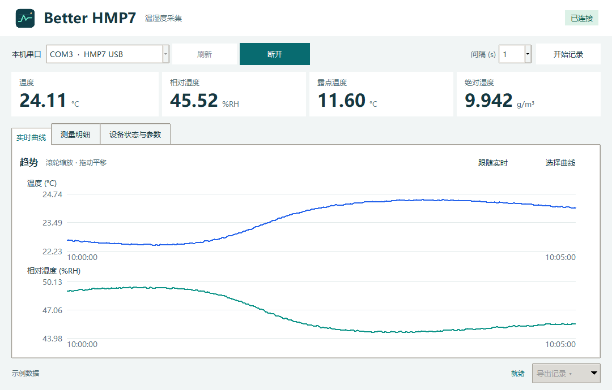

# Better HMP7

Better HMP7 是用于 Vaisala HMP7 温湿度探头的桌面采集软件。通过 USB 转接线连接探头，就能看实时曲线、记录测量值，并把一段测量导出为 Excel 或可打印的报告。采集和文件保存都在接探头的电脑上完成。

**[下载最新版本](https://github.com/wfsuki/better-hmp7/releases/latest)**

## 安装

在下载页的 **Assets** 中选择适合自己电脑的安装包。安装包已包含运行环境。

| 系统 | 选择的文件 | 安装方法 |
| --- | --- | --- |
| Windows 10 / 11（64 位） | `…windows-x64-setup.exe` | 双击安装，从开始菜单打开 Better HMP7 |
| macOS（Apple 芯片） | `…macos-arm64.dmg` | 打开磁盘映像，把应用拖到「应用程序」 |
| macOS（Intel 芯片） | `…macos-x86_64.dmg` | 打开磁盘映像，把应用拖到「应用程序」 |
| Ubuntu / Debian（64 位 x86） | `…amd64.deb` | 用系统的软件安装器打开 `.deb` 文件 |

Windows 安装包未签名，macOS 安装包未经 Apple 公证。系统可能提示确认来源。下载页提供各安装包的 SHA-256 校验文件。

## 第一次采集

1. 用配套 USB 转接线把 HMP7 接到电脑。Windows 首次连接时可能需要安装厂商的 USB 驱动。[Vaisala 官方下载页](https://www.vaisala.com/en/products/software/swinsight)
2. 关闭占用同一串口的 Insight 或其他软件。打开 Better HMP7，点 **刷新**，选中探头的串口，再点 **连接**。连接成功后即可预览温度和相对湿度。
3. 选择采样间隔（0.5 到 5 秒，步进 0.5 秒），点 **开始记录**，选择新 CSV 文件的保存位置。每次采样都会写入文件，同一段记录使用统一间隔。
4. 点 **停止记录** 结束本次采集。可以继续看实时曲线，也可以点 **导出记录** 生成 Excel 或 HTML 报告。

## 曲线与数据

- **实时曲线** 默认显示温度和相对湿度。点 **选择曲线** 可添加露点温度、绝对湿度等测量项，各自显示单位。滚轮缩放时间轴，左右拖动查看数据，双击恢复跟随。应用会记住本机勾选的曲线和采样间隔。
- **测量明细** 显示全部 18 项测量值。**设备状态与参数** 可查看探头的输出状态和配置读数。
- **原始记录** 的 CSV 包含 UTC 时间、本地时间和全部测量项。断开探头或关闭应用时会停止记录，已写入的数据保留在原文件中。Excel 适合筛选和分析。
- **测量报告** 是可以离线打开的 HTML 文件。所选曲线覆盖整段记录，并附有各测量项的最小值、平均值和最大值。用浏览器打开即可打印或另存为 PDF。

## 连接排查

| 现象 | 可以检查 |
| --- | --- |
| 找不到串口 | 重新插好转接线后点 **刷新**。Windows 上可在设备管理器查看 COM 端口，Linux 上请确认当前用户有串口访问权限。 |
| 找到端口，连接失败 | 检查端口是否被其他软件占用。应用按 Modbus RTU、19200 bit/s、8 数据位、无校验、2 停止位、地址 240 识别 HMP7。 |
| 已连接，个别测量项为空 | 在 **设备状态与参数** 检查探头是否就绪、输出是否锁定。部分读数与固件支持有关。 |

## 许可证

Better HMP7 是独立开发的工具。Vaisala 和 HMP7 用于标明适配的设备。项目源码和原创图标采用 MIT 许可证。[MIT 许可证](LICENSE) · [第三方组件声明](THIRD_PARTY.md) · [Vaisala 探头手册](https://docs.vaisala.com/r/M212022EN-M/en-US)
